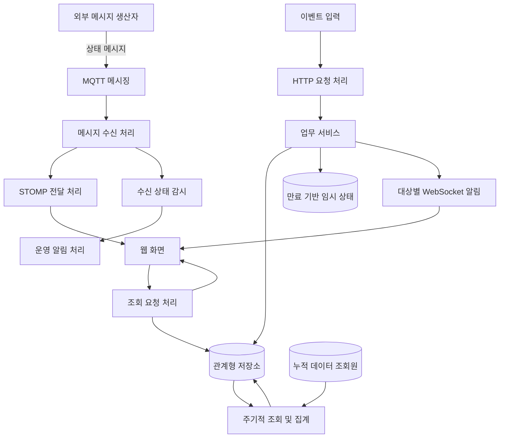
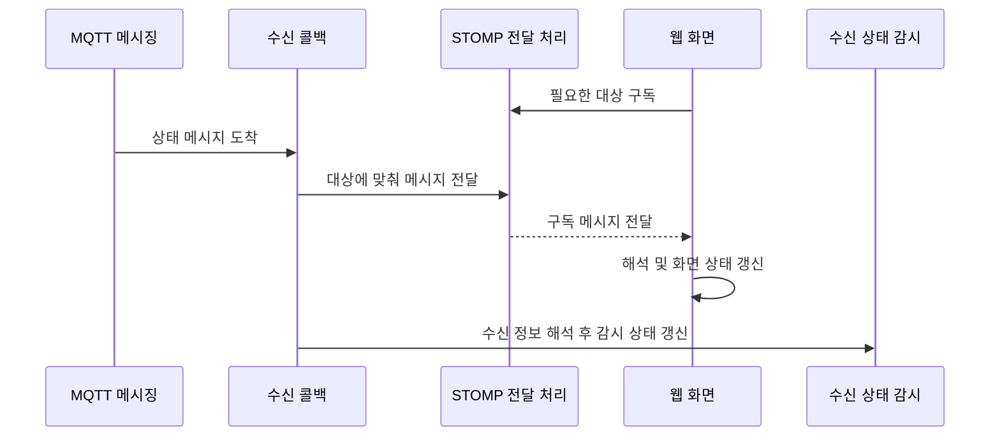
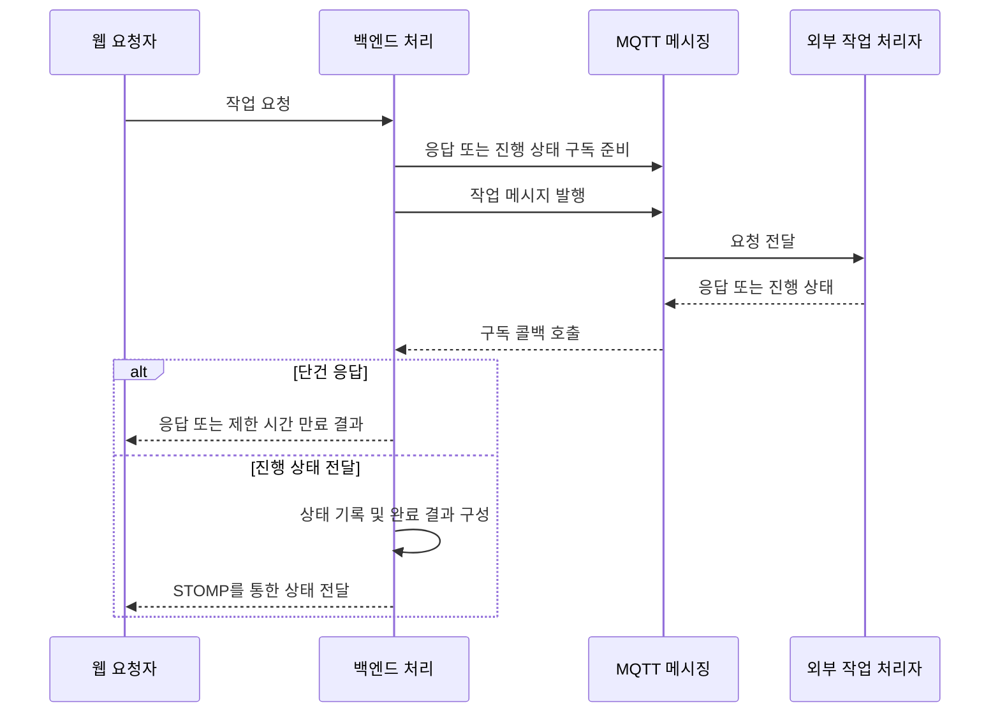

# 아키텍처와 데이터 흐름

SYMON의 주요 흐름은 실시간 상태 전달, 이벤트 저장·알림, 장치 요청·응답, 기간별 집계로 나뉩니다. 백엔드와 Vue 화면을 함께 개발해 각 흐름을 사용자 화면까지 연결했습니다.

그림은 애플리케이션의 논리적 역할을 나타내며 실제 서버·네트워크 배치를 재현하지 않습니다. 내부 주소, 메시지 주소 체계, DB 스키마와 보안정보는 생략했습니다.

## 전체 구성

실시간 상태는 MQTT에서 STOMP를 거쳐 화면으로 전달합니다. 이벤트는 관계형 DB에 이력을 저장하고 Redis의 임시 상태를 이용해 대상 사용자에게 알립니다. 누적 데이터는 별도의 조회·집계 흐름으로 처리하며, 상류 적재 경로는 이 그림에 포함하지 않았습니다.

## 실시간 수신과 화면 반영

서버는 메시지 주소 정보로 전달 대상을 구성해 페이로드를 보내고, 별도로 JSON을 해석해 수신 시각과 감시 타이머를 갱신합니다. Vue 화면은 구독 메시지를 해석해 상태를 반영합니다. STOMP 전달에는 Spring의 내부 simple broker를 사용하며 MQTT 메시징과 역할을 구분합니다.

MQTT 재연결 시에는 등록된 구독을 복원합니다. 연결 단절과 개별 데이터의 수신 지연을 나누어 처리하고, 수신 재개 시 복구 상태를 반영합니다.

## 이벤트 저장과 알림

HTTP 이벤트 입력 → 이력·메타데이터 저장 → 수신 대상 조회 → Redis 조건부 저장 결과에 따른 알림 처리 순서로 구성했습니다.

이벤트 알림은 STOMP와 별도로 직접 WebSocket을 사용합니다. 사용자별 열린 세션으로 전송하고, 연결 종료·로그아웃 시 매핑을 정리합니다. Redis 상태는 중복 알림을 억제하는 용도이며, DB 이력 저장과 알림 전송은 하나의 원자적 작업으로 묶이지 않습니다.

## 장치 요청과 진행 상태

단건 요청은 응답을 먼저 구독하고 메시지를 발행한 뒤, CompletableFuture를 통해 제한 시간 안에 결과를 기다립니다. 응답 완료와 타임아웃 시 구독을 정리합니다. 파일 작업은 진행 상태를 기록해 STOMP로 전달하고, 성공 시 객체 저장소의 임시 접근 URL을 구성합니다.

## 조회와 기간별 집계

업무 API는 Controller·Service·MyBatis Mapper로 구성하고, 인증 사용자 조회에는 JPA와 Spring Security의 세션 기반 인증을 연동했습니다. 사용자 역할·소속 범위는 업무 조회 조건과 권한 판정에 활용했습니다.

스케줄러가 Spring Batch Job을 실행하면, 일간 집계는 대상별 DynamoDB 데이터를 페이지 단위로 조회·가공합니다. 고정 크기 작업 풀의 결과를 모아 관계형 DB에 일괄 저장하고, 주간·월간 집계와 보고서 조회로 연결했습니다.

구독 복원, 요청 자원 정리, 알림과 저장의 경계 등은 [백엔드 구현 사례](IMPLEMENTATION.md)에 정리했습니다.

---

이 문서는 외부 제공 전 검토용입니다. 저장소 이름과 기술 설명을 포함한 회사의 외부 공개 허가는 별도로 확인해야 하며, Private 저장소 업로드도 확인 대상입니다.
