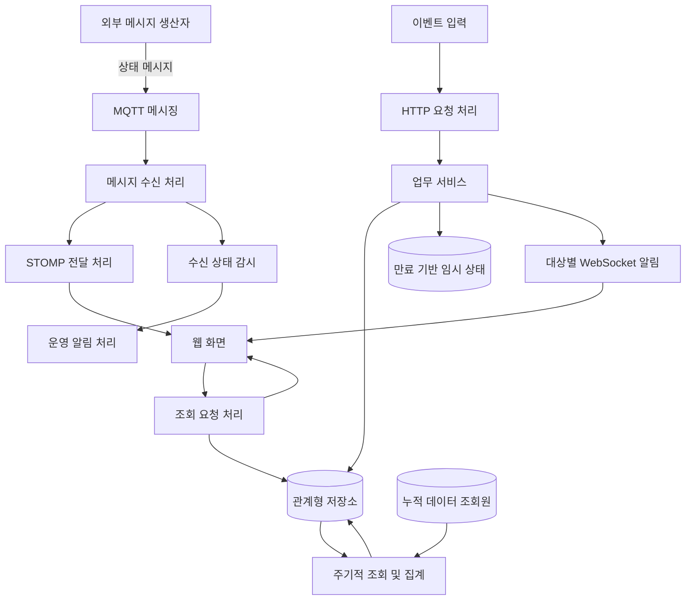
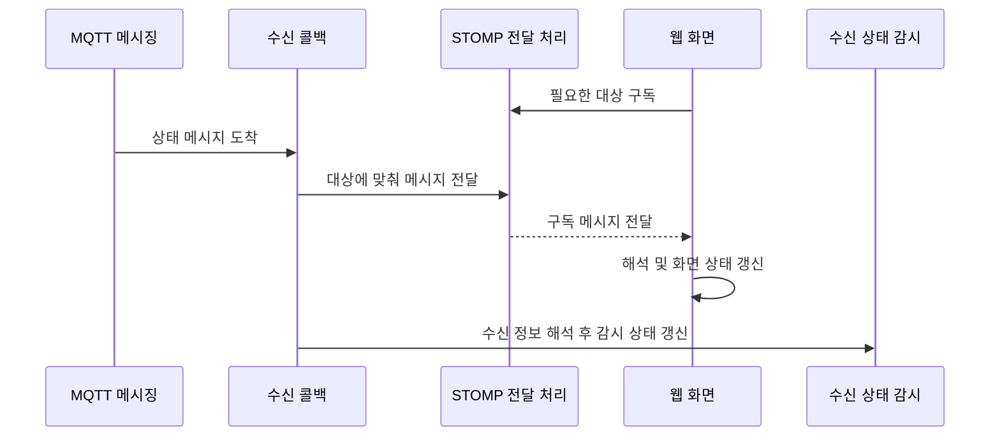
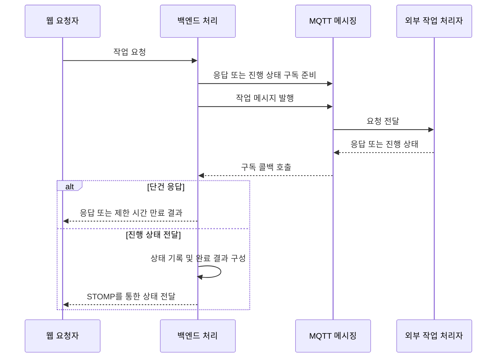

# 처리 책임과 데이터 흐름

SYMON을 1인 개발하며 백엔드와 프론트엔드 전체 개발을 담당했습니다. MQTT 수신, 웹 실시간 전달, 이벤트 저장·알림, 배치 집계와 화면 연동은 주요 구현 영역입니다.

아래 그림은 애플리케이션의 처리 책임을 일반적인 기술 개념으로 표현합니다. 운영 서버·네트워크 인프라 구축이나 기술 선택의 최종 의사결정 범위를 나타내지 않습니다.

이 문서의 노드는 논리적 역할이며 서버 수, 네트워크 구간, 리소스 배치 또는 실제 인프라 경계를 나타내지 않습니다. 모든 명칭은 설명용입니다.

## 전체 개념도

누적 데이터 조회원으로의 적재 경로는 포함하지 않았습니다. MQTT 메시지가 그 저장소에 저장되는 주체와 방식은 분석한 애플리케이션 코드만으로 확정하지 않았습니다. 실시간 상태 전달선에도 DB 저장 단계를 추가하지 않았습니다.

## 실시간 수신과 화면 반영

서버는 MQTT 메시지의 주소 정보를 바탕으로 화면 전달 대상을 구성합니다. 확인한 콜백에서는 원문 페이로드를 전달하고, 별도로 JSON을 해석해 수신 상태를 갱신합니다. 전체 메시지를 검증·영속화한 후에만 전달하는 흐름으로 설명하지 않습니다.

STOMP 전달에는 Spring의 애플리케이션 내부 simple broker 구성이 있습니다. 이 전달 역할을 MQTT broker와 구분해야 합니다. 두 역할이 별도의 운영 서버를 뜻하지는 않습니다.

## 이벤트 저장과 알림

HTTP 이벤트는 업무 서비스에서 부가 정보를 보완하고 이력과 관련 메타데이터를 관계형 DB에 기록합니다. 이후 수신 대상 사용자를 조회하고, Redis의 만료 기반 조건부 저장 결과를 이용하는 분기에서 직접 WebSocket 알림과 사용자별 임시 알림 저장을 수행합니다.

상태 메시지의 STOMP 전달과 이벤트의 직접 WebSocket 알림은 별도 구현입니다. 이벤트 알림은 대상 사용자에 연결된 열린 세션을 찾아 전송합니다. 모든 사용자에게 동일하게 방송하는 구조로 표현하지 않습니다.

DB 저장, Redis 상태 변경, WebSocket 전송을 하나의 원자적 작업으로 보장한다고 주장하지 않습니다. 알림 중복 억제 조건이 이벤트 저장 전체의 중복 제거를 뜻하지도 않습니다.

## 장치 요청과 진행 상태

단건 응답은 CompletableFuture를 완료한 뒤 제한 시간을 둔 대기로 결과를 받습니다. 파일 처리 경로는 진행 메시지를 받을 때 기록과 전달을 수행하고 완료 시 객체 저장소의 임시 접근 URL을 구성합니다. 실제 요청 식별 방식과 메시지 주소는 생략했습니다.

## 조회와 기간별 집계

업무 조회는 Controller, Service, MyBatis Mapper 및 XML SQL의 역할로 나뉩니다. 인증 사용자 로딩에는 JPA Repository를 사용합니다. 이 혼용이 저장소나 트랜잭션 관리자의 분리를 뜻하지는 않습니다.

스케줄러는 Batch Job을 시작합니다. 일간 집계는 등록 대상을 조회한 뒤 대상별 누적 데이터를 페이지 단위로 가져와 계산합니다. 제한된 작업 풀에서 조회·가공한 결과를 모아 관계형 저장소에 일괄 저장합니다. 주간·월간 집계와 이벤트·이용 이력 집계, 보고서 스냅샷 작업도 정의되어 있습니다.

## 연결 생명주기와 설명 범위

MQTT 연결 변화에 따라 구독 복구와 감시 상태 초기화가 수행됩니다. 메시지 미수신 감시는 수신 때 예약 타이머를 갱신합니다. 연결 단절과 데이터 지연을 별도 신호로 다루며 상태 변화 알림과 지연 알림 묶음 처리가 있습니다.

직접 WebSocket 알림에는 연결 등록, 종료 시 세션 제거, 로그아웃 시 매핑 정리 코드가 있습니다. 프론트에도 구독·연결 해제가 있습니다. 다중 서버 세션 공유, 무손실 보장, 장애 전환 및 재처리의 운영 보장은 입증하지 않았습니다.

실제 주소, 토픽, API 명세, DB 구조, 권한 계층, 운영 주기와 연결 파라미터는 문서에서 제외합니다.
